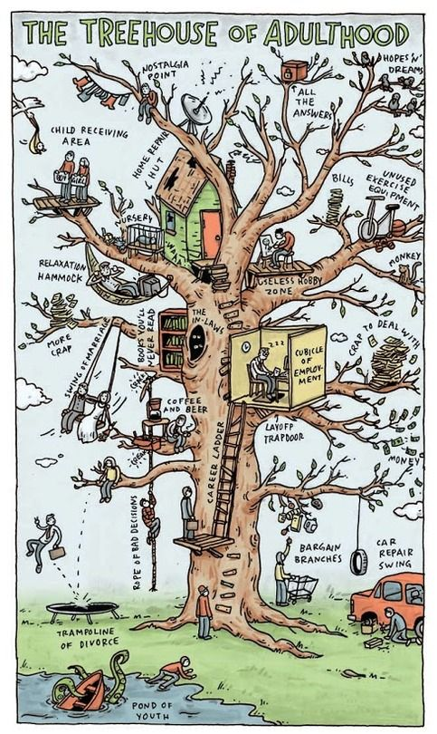

# 案例001｜The Treehouse of Adulthood 信息图分析报告

- **案例编号**：001
- **作品标题**：The Treehouse of Adulthood（成年人的树屋）
- **原图来源**：用户于2026-11-19上传的 JPG 原图
- **原图归档状态**：已嵌入本案例报告
- **作者、出版时间、原始出处**：待核实
- **五大分类**：暂不归入五大类型（经新定义复核，不符合层级型的必要特征）
- **常用类型**：插画隐喻型信息图
- **辅助标签**：文字标注型、概念性、手绘、幽默讽刺、非线性阅读

## 原图

## 1. 数据结构

非数值型定性概念集合。以成年生活为总主题，关联职业、育儿、经济负担、休闲、情感与人生阶段等多个生活主题。图像中没有可验证的统计数据或父子节点关系，树枝与场景主要承担隐喻和叙事作用。

## 2. 统计图形应用

未使用柱状图、折线图、饼图、散点图等标准统计图形。树枝的长度、粗细及场景大小不对应数值，不能据此推断统计关系。

## 3. 视觉编码

- **空间位置**：将生活主题分布于树冠、树枝、树干及地面；位置主要用于情境关联。
- **形状与象征物**：树、梯子、办公室、吊床、账单、车辆等构成具象隐喻。
- **颜色**：棕色树木、绿色草地和淡色背景建立场景一致性，而非数据类别图例。
- **文字标注**：英文短语明确局部场景的讽刺含义，如 Career Ladder、Cubicle of Employment、Bills、Pond of Youth。
- **连接关系**：树枝连接多个视觉单元，但不等同于严格数据层级边。

## 4. 信息框架

标题“The Treehouse of Adulthood”统摄整幅作品；树木是整体容器，枝干与附着物为局部主题单元。可由研究者归纳为工作与经济、家庭与责任、休闲与情感等概念框架，但图中没有明确的层级节点或统一度量。

## 5. 叙事框架

采用非线性、场景探索式阅读：标题确立成年生活的总体隐喻，读者沿树枝与局部标签自由浏览，以幽默、双关与荒诞场景拼接形成对成年生活的讽刺叙事。

## 6. 信息图形类型学分类

- **主分类（五大类）**：暂不归类。此前暂归“层级型边界案例”，现依照新版定义撤销该归属。
- **常用图形类型**：插画隐喻型信息图。
- **信息属性**：定性、概念性、非统计型。
- **表达方式**：具象插画、空间隐喻、文字标签。
- **叙事方式**：非线性、探索式、幽默讽刺。

## 分类边界与研究说明

按2026-11-19重新确立的五大类型定义复核：本作品的树形构图不等于层级型所要求的**单向、不可逆、顺序排列**的数据逻辑。局部出现“Career Ladder”等词语或梯子，但多个成年生活场景可自由阅读，整体没有必要且稳定的层级先后关系，也不能验证各层级的多关键数据结构。它不符合编年型的顺序逻辑；不具备编年型与层级型的组合，故不属于编目型；各组并非格式基本统一的均衡数据组，故不属于字母型；也不以地理图形为形式，故不属于地理图型。

**复核结果：五大主类型暂不归类；常用类型仍为“插画隐喻型信息图”。** 此结论只针对当前定义，不否定作品作为信息图或图解插画的研究价值。

## 原图存储说明

原图已在本案例报告中直接展示，不再作为独立的案例说明文件重复编写。仓库原有文件名保留为 `示例图/0b4807309d865bbbd4235dd3877e68d2.jpg`；作者、出处与授权信息核实前不得据此添加虚构来源说明。

## 五大类型复核记录（2026-11-19）

| 新定义的关键判据 | 原图观察 | 结论 |
|---|---|---|
| 数据逻辑：单向、不可逆、顺序排列 | 局部生活主题之间没有必经的先后次序，可从任意树枝阅读 | 不符合 |
| 数据维度：各层级可包含多个关键数据 | 有多个生活场景，但未形成可核验的逐层数据结构 | 不符合 |
| 视觉编码：以线性为主、具有高度可变性 | 枝干和梯子具有线条表现，但主要承担具象隐喻，不构成明确层级编码 | 不足以支持层级型 |

## 版本记录

- 2026-11-19：依据用户上传的原图建立六维分析与分类记录，并在案例001报告中嵌入展示。
- 2026-11-19：根据新版五大类型必要条件复核，撤销原“层级型边界案例”归属，标记为暂不归类。
