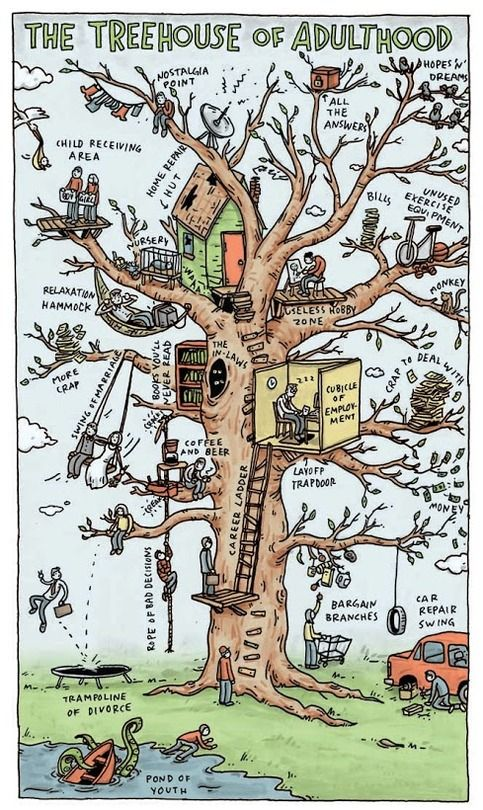

# 案例001｜《The Treehouse of Adulthood》｜层级型｜无标准统计图形

> **命名说明**：本案例按「案例编号-《具体名称》-五大分类-主要统计图形」归档；如不使用标准统计图则如实标记，不表示原作者使用 RAWGraphs 软件。

- **案例编号**：001
- **作品标题**：The Treehouse of Adulthood（成年人的树屋）
- **原图来源**：用户于2026-11-19上传的 JPG 原图
- **原图归档状态**：已上传并在本案例报告中引用
- **作者、出版时间、原始出处**：待核实
- **五大分类**：**02-层级型信息图**
- **常用类型**：插画隐喻型信息图
- **辅助标签**：人生阶段、成年生活主题、具象隐喻、文字标注、非线性局部阅读

## 原图

## 1. 数据结构与核心数据逻辑

本案例的核心数据逻辑为**「成年时期（整体人生阶段）→ 成年时期可能发生的多种生活事件和责任」**。以“成年时期”为上位框架，将工作就业、经济负担、家庭养育、休闲、情感等生活主题组织为其内部内容。

- **宏观层级**：成年时期为整体阶段，各生活事件为下位主题，体现整体与部分的从属组织关系。
- **内部事件**：各生活主题并非每位成年人必然经历的事件，也不要求按固定时间顺序发生。
- **数据属性**：非数值型、概念性、定性主题数据；没有可验证的统计量。

这里的层级是**人生阶段与其内部生活事件的主题层级**，不是严格的父子节点统计树，也不是生活事件逐项发生的时间线。

## 2. 统计图形应用

未使用柱状图、折线图、饼图、散点图等标准统计图形。树枝的长度、粗细及场景大小不对应数量，也不能据此推断统计关系。

## 3. 视觉编码

- **整体—局部组织**：树屋整体承载“成年时期”，各树枝及附着场景承载具体生活主题。
- **空间位置与连接**：通过树干、树枝、梯子等组织视线，使多个生活主题归属于同一成年阶段；位置不是严格的时间比例编码。
- **形状和象征物**：树、梯子、办公室、吊床、账单等构成具象隐喻。
- **文字标注**：例如 Career Ladder、Cubicle of Employment、Bills、Pond of Youth 等说明局部生活内容。
- **颜色**：棕色树木、绿色草地和淡色背景主要保持场景一致性，不表示统计数值。

作品使用线条与具象插画混合呈现层次，体现层级型视觉表现的可变性；**分类的首要依据仍是数据逻辑，而非树形外观本身**。

## 4. 信息框架

**成年时期**作为总主题与上位信息框架，工作、经济、家庭、休闲等生活领域作为其内部主题。通过树屋隐喻，将多个生活事件聚合在同一人生阶段之下。

## 5. 叙事框架

宏观上以成年人生阶段组织多种生活经历；局部则采用自由探索式、非线性阅读。读者可从任意枝干及标签进入作品，借幽默、双关与荒诞场景理解成年生活的不同方面。

**宏观归属的层级性**与**局部阅读的非线性**并不矛盾。

## 6. 信息图形类型学分类

- **五大主类型：层级型信息图**。
- **核心分类依据（数据逻辑）**：以成年时期作为整体人生阶段，向下组织该阶段中的多种生活事件与责任，形成上位阶段—下位生活主题的层级组织。
- **数据维度**：上位阶段承载多个关键生活主题，符合各层级可包含多个关键数据的特点。
- **视觉编码**：以树干、树枝、梯子及场景位置构成具有变化性的层次表达；属于辅助证据。
- **常用图形形式**：插画隐喻型信息图。
- **叙事**：宏观层级组织＋局部自由探索。

## 分类边界与研究说明

本案例的工作、养育、支付账单和休闲等生活事件之间**没有统一、固定且不可逆的时间先后顺序**；这并不否定其“成年时期包含多种生活内容”的上位—下位层级逻辑。

依据用户确认的解释，层级型中的单向性和顺序性在本案例中主要体现为**信息从整体人生阶段向具体生活事件展开的组织方向**，而非要求每个下位事件依严格时间顺序发生。“不可逆”应审慎地理解为这种上位与下位的组织角色不能任意对调，而不是声称成年人生活必然遵循唯一、不可逆的事件路径。

本作品因此被归为**层级型（人生阶段—生活事件主题层级）**，而非编年型；也不应仅因使用树木插画就认定属于层级型。

## 原图存储说明

报告引用仓库现有原图：`示例图/0b4807309d865bbbd4235dd3877e68d2.jpg`。不得用网络搜索图片替换用户上传原图；作者、出处和授权信息未经核实时不作推断。

## 五大类型复核记录（2026-11-19）

| 核心判据 | 本案例对应的信息逻辑 | 判断 |
|---|---|---|
| 单向的层级组织 | 从“成年时期”的整体阶段向其中生活事件展开 | 符合 |
| 层级内多关键数据 | 工作、经济、家庭、休闲等多个主题共同归属于成年时期 | 符合 |
| 事件先后与不可逆性 | 下位生活事件彼此没有严格时间先后；不可逆主要指整体与部分的组织角色不可任意对调 | 需注明边界 |
| 视觉编码 | 树形场景呈现整体与部分的多样化表达 | 辅助支持，不单独决定分类 |

**复核结论：正式归入层级型信息图；保留“插画隐喻型”常用形式标签。**

## 版本记录

- 2026-11-19：根据用户原图建立初版六维分析，并引用上传的 JPG。
- 2026-11-19：曾以严格阶段顺序标准将案例暂列五大类型之外。
- 2026-11-19：根据用户确认的“成年时期包含多种生活事件”的数据逻辑，重新归入层级型，明确宏观层级与局部事件无固定顺序的区别。
