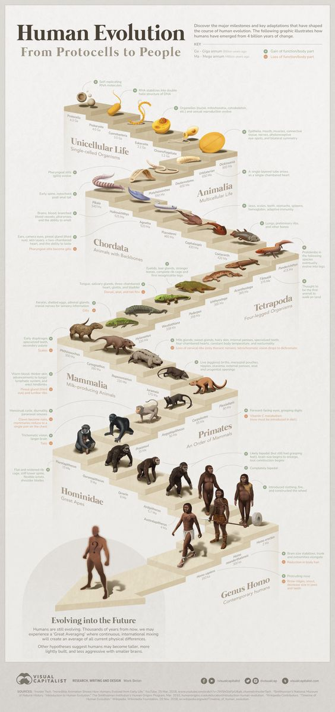

# 案例002｜《Human Evolution From Protocells to People》｜编目型｜无标准统计图形

> **命名说明**：本案例按「案例编号-《具体名称》-五大分类-主要统计图形」归档；如不使用标准统计图则如实标记，不表示原作者使用 RAWGraphs 软件。

- **案例编号**：002
- **作品标题**：Human Evolution: From Protocells to People（人类演化：从原始细胞到现代人）
- **分析依据**：用户于2026-11-19上传的原始 JPG；未使用网络替代图
- **五大主分类**：**03-编目型信息图**（编年型数据逻辑＋层级型数据逻辑）
- **常用图形形式**：演化历程型信息图
- **辅助标签**：立体阶梯式演化序列、科学插画、类群分段、注释型
- **原图归档**：已上传；文件名为 `57072069f37f75f2b88731be57d298ae.jpg`
- **作品署名**：图底部可见 Visual Capitalist；其他制作、出处细节未经独立核实

## 原图

## 1. 数据结构

本作品的数据组织并非仅是单一时间序列，而是**编年型的演化顺序与层级型的类群—内容组织相结合**。

### 编年型数据逻辑
沿从早期生命到现代人及未来演化展望的单向叙事顺序，依次呈现图中主要阶段，例如 Unicellular Life、Animalia、Chordata、Tetrapoda、Mammalia、Primates 等，逐步延伸至人类相关类群。

- **单向**：主要阅读方向沿连续演化阶梯推进。
- **顺序排列**：不同演化阶段和时间信息具有图示中的先后关系。
- **不可逆**：已设定的图示历史先后关系不能任意交换；并非指生物演化具有唯一、目的性的直线路径。

### 层级型数据逻辑
图中不同演化类群不仅是序列节点，还作为承载解释性信息的组织单元；相应位置呈现代表性生物形态、时间信息、关键特征及特征获得或失去的标记。

可抽象为：

**演化类群（阶段单元）→ 代表性生物 / 对应时间 / 关键演化特征**

各类群在生物学分类中还具有部分上下位包含关系。但这里不应把所有相邻台阶误解为严格的直接祖先—后代关系。

### 复合数据逻辑

**有先后顺序的演化阶段主轴（编年）＋各阶段包含多项相关内容的层级组织（层级）＝编目型。**

这项复合关系，而非阶梯的外形，是本案例归入编目型的主要依据。

## 2. 统计图形应用

没有使用柱状图、折线图、饼图等标准统计图形。主体采用**模拟三维空间的立体阶梯式演化序列图解**。阶梯高度、宽度和间距没有可核实的定量比例尺；时间标注虽然具有定量含义，但不能直接据此将台阶间距读作准确的时间间隔。

## 3. 视觉编码

- **位置与连续顺序**：沿阶梯从早期生命推进到人类，支持编年型主轴。
- **阶段分段与信息归属**：每个主要类群位置关联代表生物及多项旁注，支持层级型组织。
- **具象生物形态**：帮助识别演化阶段和代表性生物。
- **立体阶梯效果**：通过顶面、侧面和连续台阶呈现进程隐喻；不表示生物高低优劣。
- **文字与引导线**：对类群名称、时间和特征进行定位与解释。
- **颜色标记**：原图图例中使用不同颜色的圆点区分特征获得与失去；背景及台阶色彩用于维持视觉一致性。

## 4. 信息框架

采用**演化时间主轴＋类群分段＋阶段内部解释**的复合框架：

1. 总标题、导语与图例说明整体主题。
2. 连续阶梯组织主要演化阶段。
3. 各阶段的生物形态、时间及演化特征作为局部信息层。
4. 底部 “Evolving into the Future” 延伸为未来演化展望。

整体既能沿顺序阅读，也允许读者停留于任一类群查看内部信息。

## 5. 叙事框架

以**单向演化历程叙事**作为主线，以**分层科普解释**丰富各阶段。读者首先看到从早期生命到人类的推进，再通过生物图像和特征说明理解各阶段差异。未来演化部分属于展望性叙事，需与已发生的演化历史区分。

## 6. 信息图形类型学分类

| 分类维度 | 判断结果 | 依据 |
|---|---|---|
| 五大主类型 | **编目型** | 编年型的单向顺序和层级型的类群—多项内容组织共同构成数据逻辑 |
| 编年型特征 | 明确具有 | 时间与演化阶段沿单向序列展开 |
| 层级型特征 | 明确具有 | 主要类群作为组织单元，关联代表生物、时间和关键特征 |
| 常用图形形式 | **演化历程型信息图** | 以演化过程为主题的序列科普图解 |
| 图形表现 | 立体阶梯式图解 | 阶梯用于视觉隐喻，不是精确定量三维统计图 |
| 数据属性 | 定性分类＋时间信息＋解释性特征 | 多层信息复合呈现 |

**最终归类：03-编目型信息图；常用图形形式为演化历程型。**

### 为什么不再只归为编年型？

此前的判断主要关注时间顺序，但未充分纳入各类群所承载的多项信息。在已确认的五大分类体系中，**编目型以编年型与层级型数据逻辑的组合为核心特征**；本图两者共同存在，因而编目型是更完整的一级归类。编年型和层级型特征可作为组成逻辑记录，但不再作为两个并列的五大主分类。

## 研究边界

- 图示是一种经过简化的科普演化叙事，不能把所有现代生物理解成同一条严格直线的祖先链。
- 阶梯的高低不等于生物优劣或演化程度的等级。
- 类群—说明信息的组织层级不等于一棵精确绘制的生物系统发育树。
- 未经原始数据核实，不能将台阶间距换算为准确地质时间。
- 图中未来演化内容是展望性表达，不应与已发生历史混为同等确定性事实。

## 重新分类核验（2026-11-19）

| 主要判据 | 原图中的对应结构 | 结论 |
|---|---|---|
| 编年型：单向、不可逆、顺序排列 | 连续演化阶梯构成不能任意交换的阶段先后叙事 | 具有 |
| 层级型：有组织方向、阶段可容纳多个关键数据 | 类群作为信息单元，连接代表生物、时间与特征说明 | 具有 |
| 编目型：两种数据逻辑结合 | 沿演化序列组织多个含丰富信息的阶段单元 | **符合** |
| 视觉外观 | 立体阶梯及具象生物图像 | 辅助解释，不作为主分类的独立依据 |

## 更新记录

- 2026-11-19：依据用户原图建立六维分析，并在报告中引用原图。
- 2026-11-19：初次依据线性演化顺序判断为编年型。
- 2026-11-19：经重新拆解编年与层级两类数据逻辑，用户确认改归**编目型**，同步修订六维分析与分类依据。
