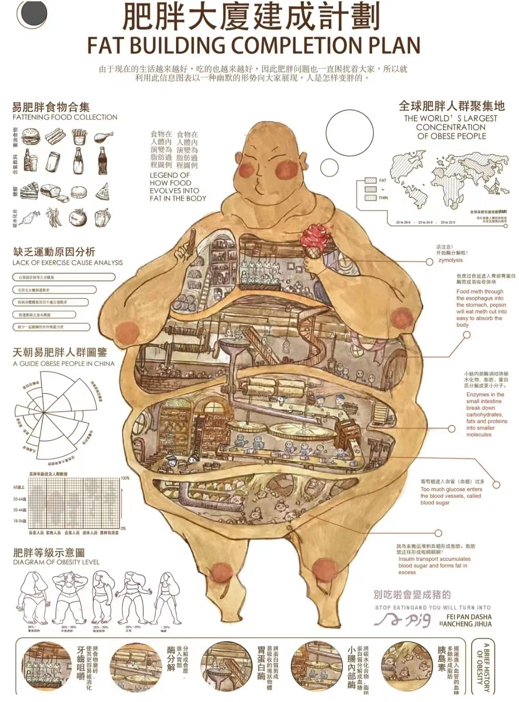

# 案例003｜《肥胖大廈建成計劃》｜编目型｜径向分区图与统计网格图

> **命名说明**：本案例按「案例编号-《具体名称》-五大分类-主要统计图形」归档；如不使用标准统计图则如实标记，不表示原作者使用 RAWGraphs 软件。

- **案例编号**：003
- **作品标题**：肥胖大廈建成計劃 / FAT BUILDING COMPLETION PLAN
- **原图来源**：用户于 2026-11-19 在对话中上传的 JPG 原图（原始文件名：`2.jpg`）
- **原图归档状态**：**已上传并确认**；原图存储于 `示例图/2.jpg`，报告直接引用该原始文件
- **作者 / 原始出处 / 制作时间**：尚未独立核实
- **五大主分类**：**03-编目型信息图**
- **常用图形形式**：**人体剖面隐喻型信息图**（可作为后续“剖面解构型”比较研究对象）
- **辅助标签**：建筑隐喻、人体消化过程、科普解释、综合统计模块、引导线注释、多图形拼合

## 原图

原图路径：`示例图/2.jpg`。已在 GitHub 目录中确认文件存在；本报告仅引用该原始 JPG，不使用网络替代图片。

## 0. 分类判断先于六维分析

依照用户确立的五大类型框架，本案例的核心在于**编年型的单向过程逻辑与层级型的上位主题—多项内容组织逻辑相结合**。主分类依据是**数据逻辑**，而非人物外形、建筑剖面或局部统计图的样式。

### 0.1 编年型数据逻辑：摄入—消化—吸收—储存

画面中部人体剖面与右侧说明共同展现了食物进入人体后的一系列过程。依据图中文字，可概括为：

**食物摄入 → 胃部消化 → 肠道进一步消化及吸收 → 营养物质进入血液并参与代谢 → 过剩能量的脂肪储存**

- **单向性**：图中主要解释沿食物进入人体后的处理方向展开。
- **顺序性**：消化、吸收及后续代谢说明存在阶段先后，不可任意交换图示步骤。
- **不可逆性（本类型学语境）**：是指**图示过程的先后逻辑不能被任意倒置**；不意味着所有相关生物化学反应在严格科学意义上都不可逆。

因此，作品明确包含编年型数据逻辑，即使它没有传统的年代标签或单一时间轴。

### 0.2 层级型数据逻辑：肥胖主题—多个信息模块

整张信息图以“肥胖的形成与相关现象”为上位主题，下设若干关键模块：

- **饮食因素**：易肥胖食物合集。
- **运动因素**：缺乏运动的原因分析。
- **人体机制**：食物进入身体后的消化吸收和脂肪积累说明。
- **肥胖程度**：肥胖等级示意图。
- **人群数据**：中国肥胖相关人群统计及类别图解。
- **地理分布**：右上角的全球肥胖人群分布地图。

这些内容不是同一时间轴上的连续事件，而是同一上位主题下多个具有不同数据字段和解释目标的子模块，呈现**整体—部分**的层级组织。

### 0.3 编目型的组合关系

**过程性编年逻辑（摄入→消化→吸收→储存）＋主题性层级逻辑（肥胖→多个关键说明模块）＝编目型。**

局部存在过程顺序即可成为复合数据逻辑的一部分，并不要求每一个外围模块都参与同一消化时间线。作品中的局部世界地图也不使其自动成为地理图型。

## 1. 数据结构

本作品为**复合型、多模块、定性与定量混合的数据结构**。

| 数据层 | 原图对应内容 | 逻辑性质 |
|---|---|---|
| 整体主题 | 肥胖形成、人体机制及相关社会现象 | 上位主题 |
| 过程数据 | 食物进入胃肠道、分解、吸收、代谢及脂肪储存 | 有先后关系的过程序列 |
| 分类数据 | 容易致胖的食物、缺乏运动原因等 | 概念类别 |
| 统计数据 | 人群年龄、肥胖程度、区域等相关子图 | 局部定量或比较数据 |
| 地理信息 | 全球肥胖人口集中地区示意 | 地图形式的辅助模块 |
| 图解数据 | 人体器官及建筑化剖面内部场景 | 定性解释性信息 |

不应将所有模块误读为一条完全统一的时间序列，也不应将概念性插画的相对尺寸当作统计数值。

## 2. 统计图形应用

这是一张以具象图解为视觉中心、组合多种辅助统计图的综合信息图，包括：

- **左侧径向分区图**：用于“天朝易肥胖人群圖鑑”等人群类别信息的可视化，具体扇区量值和比例关系需由原始数据核实。
- **左侧统计网格图**：用于表现年龄段与人群类别相关的统计比较，原图小字所对应的精确取值不在此擅自推断。
- **右上角世界地图**：用于地理区域的统计或类别分布说明，属于整体作品的局部地理图形。
- **人物体型等级示意**：通过成组人体外形说明不同肥胖等级，并非可直接读取精确数量的标准统计图。
- **中央大型剖面图解**：用于消化与脂肪积累机制解释，不属于传统柱状图、折线图或散点图。

## 3. 视觉编码

| 视觉要素 | 对应信息 | 作用 |
|---|---|---|
| 巨型人体及建筑剖面 | 肥胖与人体内部运作机制 | 以具象隐喻承载核心解释 |
| 体内楼层与机器/人物场景 | 消化、分解、吸收及物质转运等过程 | 将抽象机制空间化 |
| 剖面中的相对位置 | 人体器官或过程环节 | 表现过程及部位关联 |
| 引导线 | 中央身体局部与右侧说明文字 | 建立文本与图像的对应关系 |
| 左右信息模块 | 饮食、运动、人群、区域、等级 | 显示整体主题下的多个层次 |
| 局部统计图的分区、格网、轮廓 | 不同子模块的数量或类别 | 支持比较与识别 |
| 暖棕与米黄色主体色彩 | 人体、建筑化内部及插画风格 | 建立整体视觉一致性 |

**重点**：视觉编码高度多样化，属于分类的辅助分析。**编目型主分类首先由数据逻辑判定**。

## 4. 信息框架

整体采用**中央大型主体＋外围多模块＋右侧过程注释＋底部局部放大**的综合信息框架：

1. **顶部总标题与导语**：界定作品主题。
2. **中央人体剖面建筑**：通过插画组织消化与肥胖形成机制的主要解释。
3. **左侧信息模块**：易胖食物、缺乏运动、人群图解及肥胖等级。
4. **右上角地图模块**：全球肥胖相关地理信息。
5. **右侧引导线注释**：说明食物摄入后的消化、吸收、血糖与脂肪积累过程。
6. **底部局部详解**：从主体内部摘取细节进行补充解释。

结构上既有从总体到分项的层级，也有中央过程性信息的连续推进。

## 5. 叙事框架

采用**解释型科普叙事＋过程叙事＋建筑隐喻叙事**：

- **总体引入**：标题与夸张的肥胖人体形象吸引注意，建立议题。
- **原因与背景**：外围饮食、运动及人群信息提供背景。
- **过程说明**：人体剖面配合右侧文字讲解摄入、消化、吸收与脂肪储存之间的关联。
- **扩展比较**：通过地图、肥胖等级、人群图表将个体机制延展到群体层面。

局部过程按照既定顺序理解，其他外围模块可自由探索。因此，该图的**阅读自由度**与**过程数据的先后逻辑**可以同时存在。

## 6. 信息图形类型学分类

| 类型 | 是否具备 | 核心依据 |
|---|---|---|
| 编年型特征 | **具备** | 摄入→消化→吸收→储存等具有先后顺序的过程 |
| 层级型特征 | **具备** | 肥胖上位主题组织饮食、运动、人体机制、人群与等级等多项数据 |
| **编目型主分类** | **符合** | 编年型过程逻辑与层级型内容组织结合 |
| 字母型 | 不作为主分类 | 各模块并非统一格式、均衡排布的独立数据组 |
| 地理图型 | 不作为主分类 | 仅局部使用地理地图，并非整张作品的主要组织形式 |

**正式分类：03-编目型信息图。**

**常用形式：人体剖面隐喻型信息图。**

**核心数据逻辑摘要：肥胖上位主题包含多个关键解释和统计模块；其中人体消化吸收及脂肪储存形成具有先后关系的单向过程。**

## 研究边界与准确性说明

- 本文基于用户上传的原图进行图形组织和视觉叙事分析，而非对图中所有健康或生理文字进行医学事实核验。
- 过程“不可逆”只在本信息图类型学中指**图示过程先后不能任意交换**；不代表所有人体代谢反应完全单向。
- 图中未逐一可读的统计数字、来源年份、比例尺及详细出处不作补全或推测。
- 人体建筑剖面属于创造性视觉隐喻，不能当作真实人体解剖结构图。

## 更新记录

- 2026-11-19：根据用户提供的原图建立案例003六维分析。
- 2026-11-19：原先提出层级型初判；用户指出消化吸收过程的不可任意逆转顺序，并确认**“编年型＋层级型＝编目型”**，据此确立本案例主分类。
- 2026-11-19：分析报告归档 GitHub；此前原图二进制文件待上传。
- 2026-11-19：检查确认 `示例图/2.jpg` 已上传，报告启用原图 Markdown 展示并更新归档状态。
