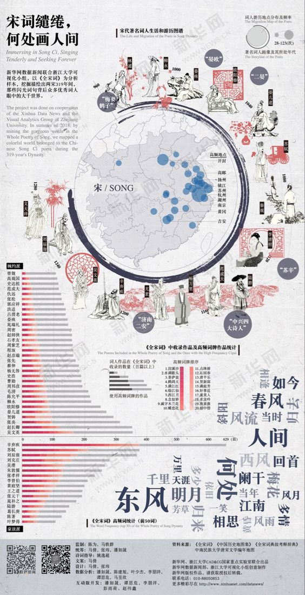

# 案例004｜《宋词缱绻，何处画人间》｜地理图型｜比例圆点地图与条形图

> **命名说明**：本案例按「案例编号-《具体名称》-五大分类-主要统计图形」归档；如不使用标准统计图则如实标记，不表示原作者使用 RAWGraphs 软件。

- **案例编号**：004
- **原图标题**：宋词缱绻，何处画人间
- **英文说明（画面所示）**：Immersing in Song Ci, Singing Tenderly and Seeking Forever
- **主题**：宋代词人生涯、游历、作品统计与宋词文化意象
- **原图来源**：用户于 2026-11-19 在聊天中上传 JPG 原图；分析以该原图为依据
- **原图文件名（本次会话）**：`e55524c653d6881ead956e3377471a54.jpg`
- **原图归档状态**：**已上传并经 GitHub 目录核验**；存放于 `示例图/e55524c653d6881ead956e3377471a54.jpg`
- **五大主分类**：**05-地理图型信息图**（用户已确认）
- **常用图形形式**：**历史文化地图型综合信息图**
- **辅助标签**：历史地图、人物游历、比例圆点、条形图、词云、传统文化插画

## 原图

原图已在 GitHub 对应目录核验存在，报告直接引用用户上传的 JPG，不使用网络替代图片。

## 0. 五大类型判断：以数据逻辑与必要形式条件为依据

### 地理图型：核心判断

原图**中央以宋代疆域与地域分界为主要图形**，在地图上叠加蓝色圆点及地名；围绕地图配置人物、生涯游历、相关历史文化和统计内容。因此，整张图的核心信息框架具有明显的**空间地域组织逻辑**，并满足本类型学对地理图型提出的必要条件——**形式上必须采用地理图形**。

地图不只是装饰性背景，而是整张作品的重要视觉与地理参照。虽然作品还包含人物时间信息、统计比较、文本词频与人物—作品的关联，它们都作为综合信息图的辅助层存在。

### 与其他四种类型的区别

| 类型 | 观察与判断 |
|---|---|
| 编年型 | 周边人物、年代等有历史先后信息，但整张图不是依唯一的单向、不可逆时间序列组织 |
| 层级型 | 总主题下有若干信息模块，但该上下位主题关系不足以取代地图的核心空间组织 |
| 编目型 | 局部可见时间与多层信息结合，但尚不足以认定整体由“编年型＋层级型”共同主导 |
| 字母型 | 统计图、人物图解、词云及地图具有不同格式，非同构数据组的均衡排布 |
| **地理图型** | **符合：以明确的历史地理地图作为主要视觉形式与空间组织依据** |

**正式归类：05-地理图型信息图。**

## 1. 数据结构

本作品属于**历史文化主题的多维复合数据组织**，涉及：

| 数据字段或实体 | 数据类型 | 主要关系 |
|---|---|---|
| 宋代词人 | 人物类别 | 与地域、生涯、词作关联 |
| 地名与宋代疆域 | 地理空间 | 地域位置和空间分布 |
| 词人生涯、游历和年代 | 时间／空间 | 人物活动及其历史背景 |
| 词作数量等 | 定量统计 | 不同人物或作品的数量比较 |
| 常见宋词词语 | 文本与频次 | 词语出现情况的比较 |
| 历史文化插画 | 定性说明 | 文化语境和人物形象的辅助叙事 |

主要关系可概括为：**宋代地域空间 ↔ 词人及其活动 ↔ 词作数量与文化意象**。中央蓝色圆点的具体数量字段与比例关系因图面标注较小，当前不作未经验证的精确断言。

## 2. 统计图形应用

- **中央历史地图＋大小不一的圆点**：表现与地域相关的信息分布。蓝色圆点的大小显然具有比较性，但准确对应指标和取值需核实图例及源数据。
- **水平条形图**：下方左侧使用大量条形进行词人或词作相关数据比较，以长度形成定量差异。
- **词云**：右下使用不同字号呈现“东风”“人间”“明月”“相思”等词语，强化宋词文本中的常见文化意象；具体频数和比例未经核实。
- **人物插画与文本标注**：提供词人身份、生涯背景及其他文化说明，不应误读为定量图。

该图是多种统计图形的组合，而非单一传统图表。

## 3. 视觉编码

| 视觉编码变量 | 信息对象 | 功能 |
|---|---|---|
| 地理轮廓与位置 | 宋代疆域、地名及相关地域数据 | 建立地图空间参照 |
| 地图圆点大小 | 地域相关比较指标（待核实） | 表现数量差异 |
| 水平条形长度 | 人物或作品相关数量 | 进行多类别比较 |
| 词云文字大小 | 词语频率或重要性 | 建立语言意象的视觉层次 |
| 人物插画 | 词人及相关历史场景 | 提供文化语境 |
| 文字标注、引导线 | 人物、年份、地名等 | 对应主体与信息 |
| 蓝灰与红色等色彩 | 地图信息、人物与视觉装饰 | 区分图层并形成传统文化气质 |

**类型判断注意**：这些视觉表现解释“如何编码”，但五大类型的归属仍以中心的地理空间组织及地理图形必要条件为核心。

## 4. 信息框架

整体采用**中心地图主导＋周边人物和文化图解＋底部统计补充**的综合结构：

1. **顶部**：作品标题、研究背景与人物、历史相关说明。
2. **中央主体**：宋代地图及分布圆点，是整张图的主要空间参照。
3. **地图四周**：人物插画、游历及相关时间标签。
4. **左下方**：大规模的统计比较条形图。
5. **右下方**：常见宋词语词组成的词云。
6. **最底部**：出处、设计信息及二维码等辅助说明（具体机构与版权信息未经核验，不擅自补写）。

## 5. 叙事框架

采用**历史文化探索式叙事＋空间分布叙事＋定量比较叙事**：

- 读者首先通过标题与地图识别宋词历史文化主题。
- 随后结合人物位置、地域名称及周边人物图像探索词人的历史空间。
- 通过左下条形比较观察数量差异。
- 通过右下词云感知宋词文化语言意象。

阅读路径总体可自由探索，并非由单一时间轴强制规定。从地图到人物、数量、词语的阅读切换形成了跨信息层次的文化解释。

## 6. 信息图形类型学分类

- **五大主类型**：**地理图型信息图**。
- **决定性判据**：地理地图是主要的图形形式与空间信息组织框架；符合用户规定的“形式上必须是地理图形”条件。
- **常用图形形式**：历史文化地图型综合信息图。
- **其他数据逻辑**：包含人物相关时间线索、人物与作品的归属关系、数量比较及文本频率等，但不改变本次确认的地理图型主分类。
- **统计图形组件**：比例圆点地图、水平条形图、词云。
- **叙事类型**：地理空间主导的历史文化探索叙事。

## 研究边界

- 中央蓝色圆点的确切含义、各类比例尺、下方统计图所用数据年份及数值应核对原始图例或源数据，不从低分辨率画面凭空补写。
- 图中出现历史年代或人物游历，不代表整个信息图的数据组织必然为编年型。
- 图中使用多个统计图形，不代表整图为字母型，也不能以普通多模块排布直接认定为编目型。
- 本案例原图已上传至 GitHub，并启用 Markdown 图片引用；不使用替代图片。

## 版本记录

- 2026-11-19：依据用户提供的原始信息图完成六维分析，建议并获确认归入地理图型。
- 2026-11-19：新增 GitHub 案例004报告；当时原图等待上传。
- 2026-11-19：GitHub 核验用户上传的原图已存在，启用报告中的图片展示并更新归档状态。
