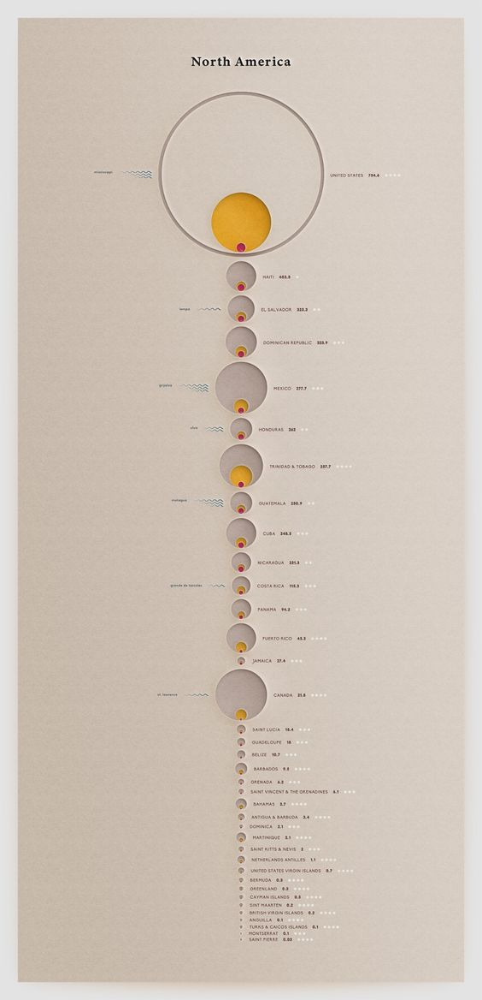

# 案例005｜《North America》｜字母型｜嵌套比例圆形图

> **命名说明**：本案例按「案例编号-《具体名称》-五大分类-主要统计图形」归档；如不使用标准统计图则如实标记，不表示原作者使用 RAWGraphs 软件。

- **案例编号**：005
- **作品标题**：North America（北美洲）
- **原图来源**：用户于2026-11-19上传的 JPG 信息图
- **原图文件名**：`04f5f974041fd5f66c3c4ea5f448445d.jpg`
- **原图归档状态**：**已上传并经 GitHub 目录核验**；原图路径为 `示例图/04f5f974041fd5f66c3c4ea5f448445d.jpg`
- **作者、时间、统计口径、出处**：待核实
- **五大主分类**：**04-字母型信息图**（用户已确认）
- **常用图形形式**：嵌套比例圆形图（含纵向数值排序）
- **辅助标签**：同构数据组、比例圆、圆形套叠、数值比较、长尾分布、极简排版

## 原图

原始 JPG 已在 GitHub 对应目录中核验，报告直接引用用户上传的文件，不使用网络替代图片。

## 0. 五大类型分类判断（数据逻辑优先）

**正式主分类：字母型信息图。**

此作品将北美洲的国家或地区作为多个**彼此独立、数据格式基本统一**的比较单元：每一单元以重复的圆形及其内部彩色圆、名称与数值共同呈现。虽然所有单元沿纵向从较大到较小排列，但这是**数量大小排序**，不是具有单向不可逆演进关系的时间或过程顺序。

| 五大类型 | 判断 | 依据 |
|---|---|---|
| 编年型 | 不符合 | 不存在从一个国家必然推进到另一个国家的不可逆过程关系 |
| 层级型 | 不符合 | 主要数据组之间未展示必须依次展开的上下位层级关系 |
| 编目型 | 不符合 | 未出现编年与层级两种逻辑的组合 |
| **字母型** | **符合** | 多个格式基本统一的国家或地区数据组，纵向均衡排列；不依赖固定的过程顺序 |
| 地理图型 | 不符合 | 虽然以北美洲为题材，但未使用地理地图形态组织各国数据 |

**类型边界说明**：这里的“字母型”是本信息图类型学的正式分类名，**不表示必须按照字母表排序**。图中的定量排序不等于编年型顺序。

## 1. 数据结构

本案例为**多个独立对象构成的同构定量比较数据**。

- **观察对象**：北美洲国家或地区（如 United States、Haiti、El Salvador、Dominican Republic、Mexico、Canada 等）。
- **名义字段**：国家或地区名称。
- **定量字段**：各单元右侧的数字（确切统计指标与单位尚未从原图核实）。
- **排序字段**：数值大小所形成的纵向先后。
- **可能的附加数据字段**：内嵌黄色和洋红色小圆所表达的子数值或构成关系（具体含义未核实）。

其基本组织为：

**国家或地区 → 对应数值 → 统一的圆形视觉单元**

国家或地区之间彼此独立；交换上下位置不会改变单个对象与其数值的对应关系，因此不存在不可逆演进的过程逻辑。

## 2. 统计图形应用

主要运用**重复排列的嵌套比例圆形图**：

1. **外部圆形**：不同国家或地区的整体圆形尺度存在显著差异，表现对象之间的数量比较。
2. **内部黄色圆与洋红色标记**：重复出现于多个单元内，呈现内部子部分或额外变量的视觉层次，但其真实数据意义尚待核实。
3. **纵向排序排列**：总体按大小由上至下形成大对象到小对象的长尾比较。
4. **右侧文字与数字**：用于辨认国家或地区，并提供数值信息。

**核验边界**：图中没有足够清晰可辨的完整指标说明、单位和比例尺，因此不能确认外圆面积与数值严格成正比，也不能擅自确定内部圆的统计含义。

## 3. 视觉编码

| 视觉变量 | 表现对象 | 作用 |
|---|---|---|
| 圆形大小 | 国家或地区之间的数量差异 | 主要量化比较 |
| 纵向位置 | 单元按数值排列的顺序 | 强化大小差距与长尾结构 |
| 重复圆形格式 | 各国家或地区 | 保持不同数据组的视觉一致性 |
| 内嵌黄色与洋红色圆 | 可能的附加数据（待核实） | 形成多层信息对照 |
| 名称与数字 | 国家或地区及其指标 | 明确标识和支持查读 |
| 浅米色背景及细腻阴影 | 整体视觉风格 | 增加层次与材质感 |

**分类仍以数据逻辑为主**；一致的圆形编码是对字母型“各组格式基本统一”特征的进一步佐证。

## 4. 信息框架

采用**单列纵向排列＋重复圆形数据单元＋右侧统一标注**的框架。

- **顶部**：North America 标题。
- **主体**：由大到小排列的一系列圆形单元，各组采用基本统一的外圆、内圆、文字和数值组合。
- **右侧标注**：各国家或地区名称和数值对应各组。
- **局部辅助标记**：部分单元侧边出现细线或波纹类装饰／说明符号，具体含义待核实。

整体为同构、可逐项比较的数据阵列，而非地理位置图或时间线。

## 5. 叙事框架

采用**排序式比较叙事**：

**最显著的大圆 → 中等圆形 → 逐渐缩小的数据组 → 大量极小的长尾对象。**

读者可从上到下进行比较，也可直接查找任一国家或地区。图中的顺序是为了强化数量差异，而不是表达历史必经步骤。因此，阅读路径虽然具有明显的方向性，但数据逻辑不具编年型意义上的不可逆性。

## 6. 信息图形类型学分类

- **五大主类型**：**字母型**。
- **核心数据逻辑**：多个国家或地区构成独立、同构的数据组；各组信息结构基本一致，不存在必须遵循的不可逆过程。
- **数据维度**：每组采用统一的数据字段及图形格式，具有相互比较的基础。
- **视觉编码**：统一的嵌套圆形、大小变化、纵向排列和对应数值标注。
- **信息框架**：单列纵向的同构数据单元阵列。
- **叙事方式**：数值排序式探索与长尾比较。
- **常用图形形式**：嵌套比例圆形图。

## 分析边界和待核实事项

1. 仅凭现有原图无法严谨确定**数值所指统计指标和单位**；不得猜测为人口、面积、GDP 等任何特定指标。
2. 外部圆形与内部黄色、洋红色标记的准确数值编码，需找到完整图例或原始来源后核实。
3. 原图已在 GitHub 对应目录核验存在，并已启用正式 Markdown 图片引用。
4. 各数据组按照数值排序不等于编年型；区分依据是是否存在单向、不可任意交换的过程逻辑。

## 更新记录

- 2026-11-19：依据用户上传的原始信息图完成案例005六维分析，提出并获确认归入**字母型信息图**。
- 2026-11-19：建立 GitHub Markdown 分析报告，原始 JPG 当时待独立上传。
- 2026-11-19：核验原图已上传，启用报告中的图片展示并更新归档状态。
