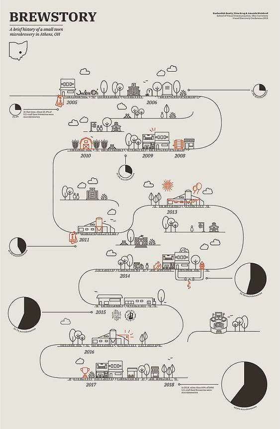

# 案例006｜《BREWSTORY》｜编年型｜无核心标准统计图形（辅助扇区图）

> **命名说明**：本案例按「案例编号-《具体名称》-五大分类-主要统计图形」归档；如不使用标准统计图则如实标记，不表示原作者使用 RAWGraphs 软件。

- **案例编号**：006
- **作品标题**：BREWSTORY
- **原图副标题**：A brief history of a small town microbrewery in Athens, OH
- **作品主题**：美国俄亥俄州雅典市一家小型精酿啤酒厂在2005—2018年间的发展历程
- **原图来源**：用户于2026-11-19在对话中上传的JPG原图，分析依据为该图片本身
- **原图文件名**：`3ba41d05f6f6c0ddc8da424109daae2f.jpg`
- **原图归档状态**：**已上传并经 GitHub 目录核验**，存储于 `示例图/3ba41d05f6f6c0ddc8da424109daae2f.jpg`；不使用替代图片
- **五大主分类**：**01-编年型信息图**（用户已确认）
- **常用图形形式**：**蛇形时间线信息图**
- **次级特征**：历史发展叙事、折返式曲线、事件插画、局部比例统计

## 原图

原始 JPG 已在 GitHub 对应目录中核验存在，此处直接引用原图。

## 0. 五大类型主分类判断

**正式主分类：编年型信息图。**

按照用户确立的五大信息图类型定义，**数据逻辑是五大主分类的首要判断依据**。本图通过一条连续、蛇形折返的路线，串联2005至2018年的企业发展事件；年份及对应事件不可任意交换，形成明确的历史先后。

| 类型 | 结论 | 核心判断依据 |
|---|---|---|
| **编年型** | **符合（主分类）** | 2005—2018的发展事件形成单向、不可逆、依次排列的历史序列 |
| 层级型 | 不作为主分类 | 建筑、事件与统计信息服务于时间节点，未构成独立主导的多层级数据组织 |
| 编目型 | 不符合整体主导逻辑 | 时间序列清楚，但局部插画、圆形统计不足以构成与编年逻辑并列主导的层级型数据结构 |
| 字母型 | 不符合 | 不同年份事件不能随意交换，组间不是无先后要求的均衡并列 |
| 地理图型 | 不符合 | 地点是作品背景，主图并不是地理地图 |

这里的“不可逆”指**已发生历史事件的先后关系不可随意倒置**，并不意味着企业经营的所有决策和变化都不可能在现实中逆转。

## 1. 数据结构

本案例以**时间维度为主的单维序列数据**组织信息，并在个别年份节点附加事件和数量说明。

| 数据字段 | 数据类型 | 作用 |
|---|---|---|
| 年份（2005—2018） | 时间型 | 确定发展先后和主要阅读顺序 |
| 年份相关事件 | 定性事件数据 | 记录各阶段的变化 |
| 建筑和经营设施图像 | 具象解释数据 | 将发展事件转化为可识别的场景 |
| 局部圆形扇区统计 | 定量比例数据 | 为选定年份的事件补充数值说明 |
| 位置（Athens, OH） | 地理背景 | 交代企业所在地区，而非主要图形轴 |

基本数据逻辑：

**年份 → 对应发展事件 → 少量补充说明或统计数据。**

年与年的先后关系构成作品主骨架；其他数据跟随年份出现，并没有取代时间维度的主导性。

## 2. 统计图形应用

- **蛇形折返时间线**：全图主要的结构性图形，使用连续线条将发展年份串接。
- **圆形扇区图**：数个局部百分比或占比图，补充节点对应的统计信息；图片中小字号的具体指标、分母与比例值未逐项核实，不在此补造。
- **图标化事件图解**：以建筑、植物、车辆、奖杯等插画表示不同时期的设施、活动或荣誉，属于定性图解，不可用其几何大小推断数值。

时间线的物理长度与历史年份的时间间隔未给出可验证的比例尺，因此**不是严格等距、定量校准的时间坐标轴**。

## 3. 视觉编码

| 视觉变量 | 原图表现 | 信息作用 |
|---|---|---|
| 连续线条 | 在长幅画面中多次回转的路线 | 建立统一时间主轴 |
| 路线上的排列位置 | 各年份与事件节点 | 表达阶段先后 |
| 年份文字 | 2005、2006、2008等直至2018 | 明确时间身份 |
| 具象建筑/设施插画 | 建筑、车辆、植物等 | 解释企业历史事件 |
| 红色强调 | 图示局部事件或元素 | 在黑白主调中建立视觉焦点 |
| 圆形扇区面积 | 局部占比信息 | 辅助统计比较 |
| 文字标注和引导线 | 事件相关说明 | 连接数据与图像 |

**编码以线性为主，表现形式具较高度可变性。** 主体线条不采用简单直线，而使用多次折返的连续曲线；曲线转向不意味着时间倒流。

## 4. 信息框架

作品采用**纵向长海报＋蛇形时间主线＋局部图解和统计标注**的结构。

1. **顶部标题**：BREWSTORY及副标题明确企业与历史主题。
2. **主体时间路线**：2005至2018的连续弯曲路线，按时间推进排列节点。
3. **插画场景**：建筑、植物、车辆、人物或奖项等元素紧贴相应年份。
4. **外围统计模块**：通过引导线连接个别时间节点与圆形扇区图。
5. **结尾阶段**：较晚年份排列在下方，以终点形式结束发展叙事。

折返布局主要为了在限定宽度的纸面内容纳较长时间序列，不应将其误读为真实道路或地理路线。

## 5. 叙事框架

采用**线性历史发展叙事**。读者沿连续时间线了解一家小型精酿啤酒厂在不同年份的发展及变化：

**起始时期（2005） → 中间发展年份 → 后续经营与设施变化 → 2018年阶段性结尾。**

建筑、设备和其他局部符号帮助展示不同阶段的变化；少量扇区统计图则对某些节点提供补充。时间顺序决定阅读路径，故属于典型的编年型叙事。

## 6. 信息图形类型学分类

- **五大主类型**：**编年型信息图**。
- **核心数据逻辑**：单向、不可逆、按历史先后顺序排列的企业发展事件。
- **数据维度**：以单一时间序列为主，仅有有限的延伸性图形、比例与注释。
- **视觉编码**：以连续线性为主，蛇形折返的布局体现高度可变的线性表达。
- **信息框架**：连续折返路线＋年份节点＋事件插画＋局部统计。
- **叙事框架**：企业发展史的线性历程。
- **常用图形形式**：蛇形时间线信息图。

### 与案例002的分类边界

案例002《Human Evolution》在演化阶段顺序之外还以类群为单元组织多项代表性生物、时间和演化特征；根据已确认的复合数据逻辑，主分类是**编目型**。

案例006虽然存在局部比例图和多种事件插画，但**主要数据仍沿单一时间主轴展开**，尚无足够证据表明另一条层级型结构与其共同主导整体。因此更适合归为**编年型**，而不是编目型。

## 研究限制

- 本次分类基于用户上传的原始图片，不使用替代图。
- 图中事件的具体名称、局部扇区的精确比例、相关机构名称与统计口径若未能从画面清晰辨认，均不做无依据补全。
- 曲线形态属于视觉布局形式，并不表示地理空间上的真实行进路线。
- “不可逆”作为类型学判据指历史事件的先后关系不可随意颠倒，而不是企业运营中的所有行为都无法撤销。

## 版本记录

- 2026-11-19：依据用户原图完成案例006六维分析，分类为编年型，常用形式为蛇形时间线信息图。
- 2026-11-19：获用户同意，将分析报告及类型索引提交 GitHub；当时原图仍待单独上传。
- 2026-11-19：核验原图已上传，启用 Markdown 图片引用并更新归档状态。
