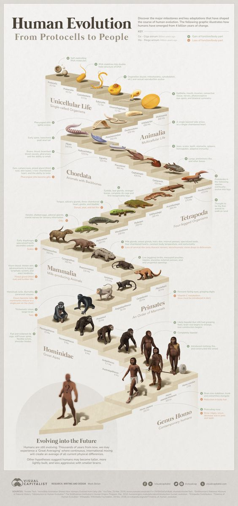

# 案例002｜Human Evolution: From Protocells to People 信息图分析报告

- 案例编号：002
- 标题：Human Evolution: From Protocells to People（人类演化：从原始细胞到现代人）
- 分析依据：用户于2026-11-19上传的原图；未使用替代图
- 五大主分类：01-编年型信息图
- 常用类型：演化历程型信息图
- 次级标签：立体阶梯式演化序列、科学插画、注释型
- 原图归档：**已上传**；原图文件名为 `57072069f37f75f2b88731be57d298ae.jpg`
- 作品署名：图底部可见 Visual Capitalist；其余制作和来源细节以原图底部小字为准，未另行核实

## 原图

## 1. 数据结构

时间与阶段顺序为主，结合定性分类和部分时间数值。画面从早期原始生命沿阶梯展示 Unicellular Life、Animalia、Chordata、Tetrapoda、Mammalia、Primates、Hominins 等主要演化阶段，并标示代表性的生物形态和关键特征。

## 2. 统计图形应用

无常规柱状图、折线图、饼图等。主要使用模拟三维空间的立体阶梯式演化序列图解；阶梯的高度、宽度、间距并非经过明确比例尺校准的定量编码。数字时间标签具有定量含义，但阶梯整体不能据此解释为严格比例时间轴。

## 3. 视觉编码

- **位置与顺序**：从画面上部沿阶梯逐步向下，表现从早期生命到人类的演化序列。
- **形状**：不同生物的具象模型对应代表性生命形态。
- **立体阶梯**：作为阶段推进的空间隐喻，不代表生物优劣或进步等级。
- **文字**：分类名称、时间与演化特征旁注构成解释层。
- **颜色**：米色背景及阶梯保持视觉统一；绿色与橙色圆点在图例中分别指示特征获得与失去。
- **引导线**：细线连接特征描述和相应生物/阶段。

## 4. 信息框架

总标题和导语引入主题，图例说明特征获得/失去的标记，主体以阶段阶梯串联主要生物类群，局部标注补充时间与适应性特征，底部以 “Evolving into the Future” 延伸至未来演化展望。

## 5. 叙事框架

线性时间叙事结合解释型科普叙事：原始生命为开端，沿阶梯展示代表类群和关键特征，现代人阶段为叙事高潮，最后加入未来人类演化的推测性结尾。

## 6. 信息图形类型学分类

- 五大主类型：**编年型**，依据为明确的时间标注和演化先后顺序。
- 常用类型：**演化历程型信息图**。
- 次级表现：立体阶梯式时间序列、科学插画、注释型信息图。
- 数据属性：定性与时间定量混合。
- 叙事：线性历程 + 解释 + 推测性未来展望。
- 与层级型区别：虽包含生物类群名称，但未绘制严格的父子分类树，主轴为时间顺序。

## 研究边界

该图使用代表性生物和连续阶梯进行科普简化，不能解读为所有现代生物都处于同一条直线祖先链，也不能以阶梯高低衡量演化程度。未经原始数据和权威出处核实，不应据图推断演化时间的精确比例关系。

## 五大类型复核记录（2026-11-19）

| 新定义的关键判据 | 原图观察 | 结论 |
|---|---|---|
| 数据逻辑：单向、不可逆、顺序排列 | 按早期生命到人类及未来展望组织阶段，图中先后次序不可任意颠倒 | 符合其叙事顺序逻辑 |
| 数据维度：单维为主、较少延伸数据 | 以一条主要演化阶段序列为骨架；生物形态、时间和特征注释属于延伸信息 | 基本符合（注释信息较丰富） |
| 视觉编码：以线性为主、具较高度可变性 | 通过连续的立体阶梯模拟一条演化方向，使用位置、标签及引导线辅助 | 符合线性序列的变体表现 |

**复核结果：保留“01-编年型信息图”作为五大主分类。** 这里的“不可逆”仅指图中表达的先后阶段不可任意交换；并非断言真实生物演化只有一条不可逆的直线祖先链。图中出现生物分类名称和多个特征说明，但不足以把主分类改判为层级型或编目型。

## 更新记录

- 2026-11-19：依据用户原图完成案例002六维分析，并在报告中嵌入原图。
- 2026-11-19：根据新版五大类型数据逻辑、维度及视觉编码标准复核，保留编年型归属，并明确“不可逆”仅限图示叙事顺序。
